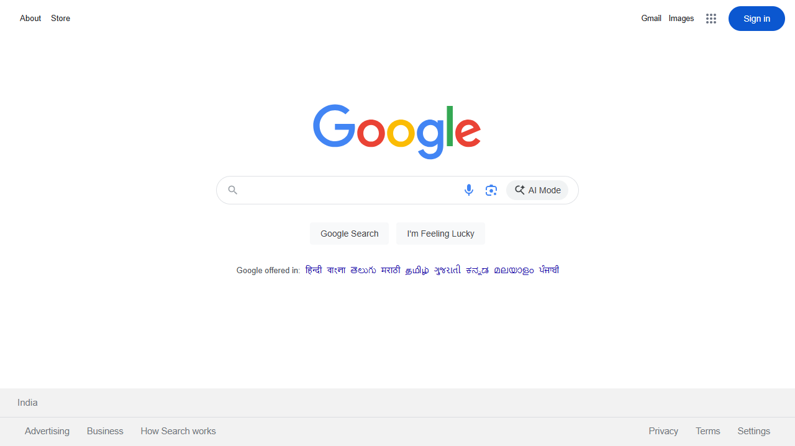
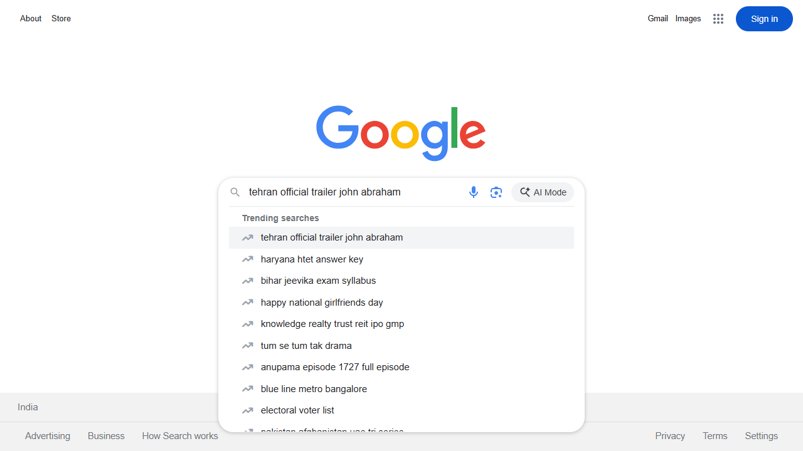
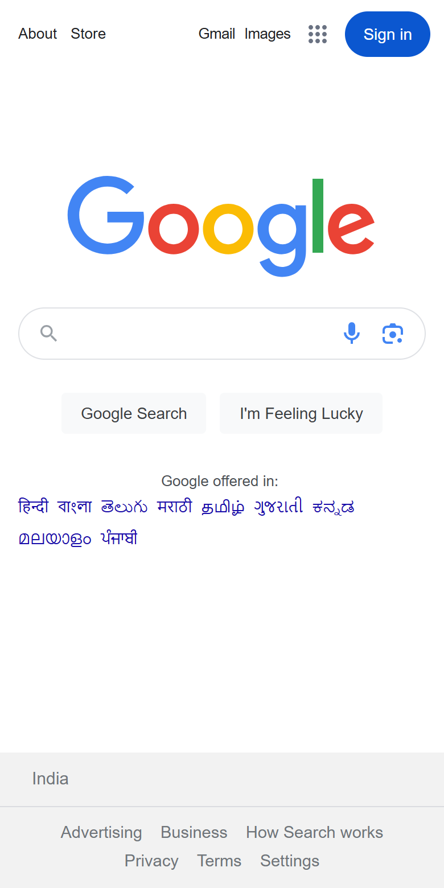

# Google Page Clone

A responsive clone of the Google homepage built with HTML and [Tailwind CSS](https://tailwindcss.com/) v4.

**Live demo:** https://google-page-clone-wheat.vercel.app/



## Features

- Pixel-close Google homepage: logo, search card, buttons, language links and footer
- Working search form (Google Search / I'm Feeling Lucky, Enter to submit, empty searches ignored)
- Trending-searches dropdown inside the search card, with click and keyboard (↑ / ↓ / Esc) support
- Responsive from 320px phones to large desktops
- Accessible: labelled controls, semantic links and buttons, listbox roles

## Screenshots

| Suggestions | Mobile |
| --- | --- |
|  |  |

## Getting started

```bash
npm install
npm run build   # one-off minified build of output.css
npm run dev     # rebuild on change
```

Then open `index.html` in a browser.

## Project structure

| File | Purpose |
| --- | --- |
| `index.html` | Markup and the small search/dropdown script |
| `input.css` | Tailwind entry point |
| `output.css` | Generated stylesheet (`npm run build`) |

## Disclaimer

This is a learning project and is not affiliated with Google.
